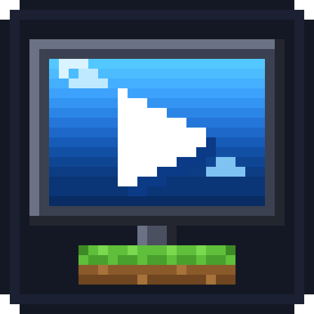

# ScreenMine

A real Chromium browser as a flat screen in the Minecraft world: spawn it, move
it, resize it, browse and watch YouTube from inside the game. Client-side only,
works solo with no server.

Port of [CoScreen](#credits-and-licence) from Minecraft 1.21.4 to
**Minecraft 26.3** (Fabric).

> **Work in progress.** The port is still under construction on the `port/26.3`
> branch. `main` currently carries only a render spike and builds, but is not a
> usable mod. See [`progresso.md`](progresso.md) for where things stand.

## Requirements

- Minecraft **26.3** ("Wilderness Bound")
- Fabric Loader 0.19.5+
- Java **25**
- Fabric API 0.163.0+26.3
- [mcef-modern](https://github.com/DimasKama/mcef-modern) 0.3.3+mc26.3 — the
  embedded Chromium runtime. It downloads Chromium (~200 MB) on first launch, so
  screens render as grey rectangles until that finishes.

## Credits and licence

ScreenMine is a port of **CoScreen**, authored by **Ma3stro567**, which was
distributed under the GNU Affero General Public License v3.0. Substantial parts of
its source were carried over and modified. See [`NOTICE`](NOTICE) for the full
attribution, the files involved, and the changes made.

ScreenMine is licensed **AGPL-3.0-only**. Full text in [`LICENSE`](LICENSE).

CoScreen does not state whether its grant was `-only` or `-or-later`: it has no
licence field in its `fabric.mod.json`, no licence headers in its sources, and no
grant statement anywhere. Its `LICENSE` is the unmodified FSF boilerplate, where
`AGPL-3.0 section 14` lets whoever receives the work choose any published version.
`AGPL-3.0-only` here is a conservative choice made by ScreenMine's author, **not**
a statement about what CoScreen intended.

Resolving this needs the upstream author. Only **Ma3stro567** can say whether
CoScreen is `-only` or `-or-later`, and only they can permit re-licensing. Until
then the ambiguity stands. An issue still needs to be opened on CoScreen asking; once answered, the`r`nresult will be recorded in `NOTICE`.